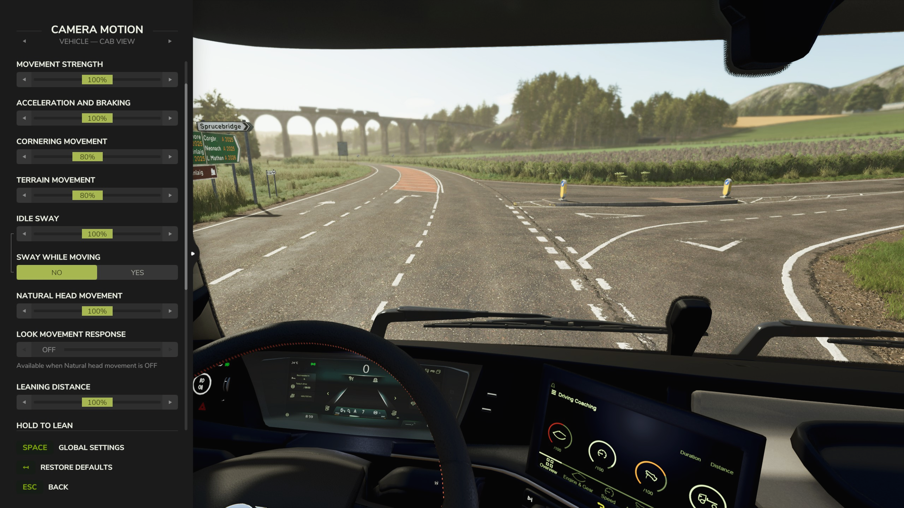
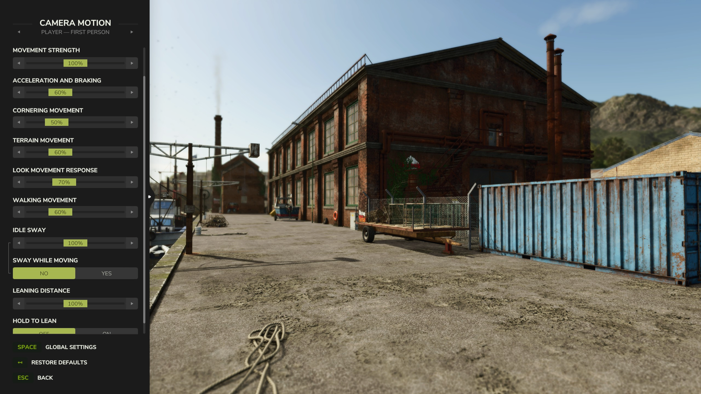
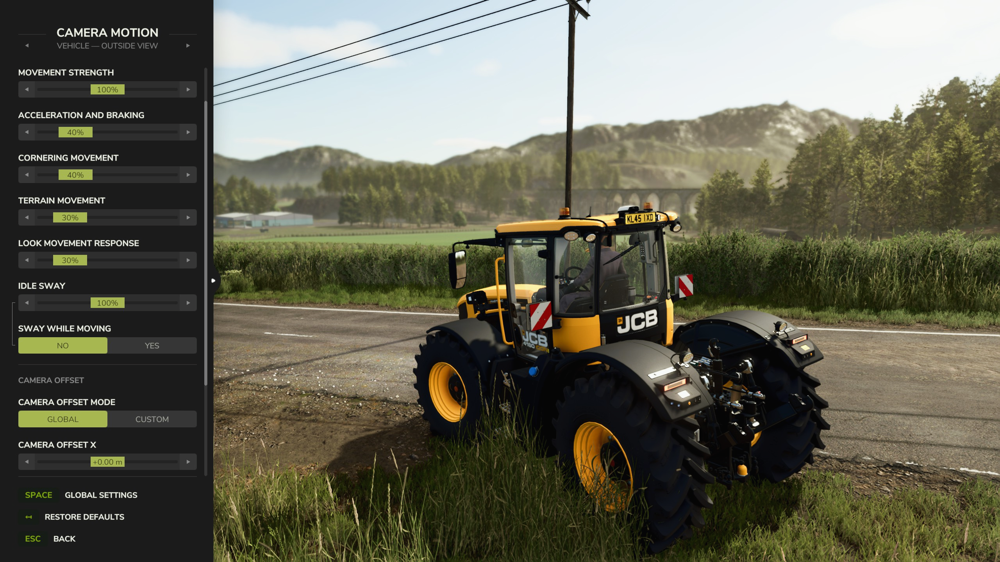

   
  <b>Camera Motion</b> adds natural camera movement and subtle swaying &mdash;
   
  with smooth reactions to acceleration, braking, cornering and uneven terrain.
   
   

## Features

- **Natural Camera Motion:** Smooth camera reactions to acceleration, braking, cornering, walking and uneven terrain.
- **Four Camera Profiles:** Configure vehicle and player cameras independently in first and third person.
- **Simple or Advanced Control:** Adjust all movement with one strength slider or fine-tune individual effects in advanced mode.
- **Head Movement & Leaning:** Add natural head movement in the cab and lean in first-person views using press or hold controls.
- **Idle Sway:** Add subtle camera movement while stationary, with an option to keep it active while moving.
- **Vehicle Camera Offsets:** Set global offsets or save custom camera positions for individual vehicles.

## Installation

1. Download the latest version of the mod from the [Releases](https://github.com/modnext/cameraMotion/releases/) page or the official [ModHub](https://www.farming-simulator.com/mod.php?mod_id=376875).
2. Copy the downloaded `.zip` file to your Farming Simulator mods folder:
   - Windows: `Documents\My Games\FarmingSimulator2025\mods\`
   - macOS: `~/Library/Application Support/FarmingSimulator2025/mods/`
   - Linux: `~/FarmingSimulator2025/mods/`
3. Start Farming Simulator 2025 and enable the mod in the Mods menu.

## Keybindings

| Key              | Action                                                                    |
| ---------------- | ------------------------------------------------------------------------- |
| `F9`             | Open the Camera Motion settings.                                          |
| `Mouse Button 4` | Press or hold to lean in first person, depending on the selected setting. |

You can customize these keybindings in the game's Options menu under the "Camera Motion" section.

## Screenshots

## License

Distributed under the GPL-3.0 license. See [LICENSE](LICENSE) for more information.
